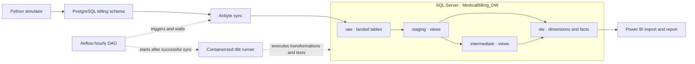

# Medical Billing Data Platform

An end-to-end data engineering portfolio project that traces synthetic medical charges through claim submission, adjudication, payments, adjustments, and outstanding accounts receivable (A/R). An hourly Airflow DAG coordinates ingestion and a tested dbt warehouse build. A three-page Power BI report uses the warehouse to explore financial performance, denials, and collection speed.

## Business problem

Billing teams need to know how much was billed and collected, where denials are concentrated, and which balances remain open. Charges, claim events, payments, and adjustments occur at different grains and on different dates. Joining those records directly can multiply financial amounts. This project keeps transaction and event grains explicit, aggregates payments and adjustments independently at the claim-line grain, and reconciles the resulting balances with automated tests.

## Architecture and evidence



- **Report source** includes Executive Summary, Denials & Leakage, and Collection Curves, with DAX measures and model relationships stored in version control. [Power BI project](Reports/Medical%20Billing%20Report.pbip) · [Semantic model](Reports/Medical%20Billing%20Report.SemanticModel/definition)
- **Execution evidence** from a local dbt development build recorded 23 successful models and 132 passing data tests. Local deployment history contains successful deployments and a rollback. The generated logs and state are local artifacts.
- **Screenshot placeholder** for the Executive Summary and an Airflow run showing both tasks complete.

## How the pipeline runs

1. **Python and PostgreSQL** generate and store synthetic reference data and operational activity across 10 tables. The simulator runs as a separate process, with historical seeding and accelerated billing activity.
2. **Airbyte** replicates the PostgreSQL streams to SQL Server. dbt expects the 10 landed relations in `MedicalBilling_DW.raw`. Airbyte provisioning and replication mode are configured externally.
3. **Airflow** triggers the Airbyte job and waits for success. It then starts a Docker runner using `DBT_IMAGE` and executes `dbt build --target prod`. The DAG runs hourly in UTC when unpaused, with catchup disabled and one active run at a time.
4. **dbt Core and SQL Server** normalize active rows in 10 staging views, calculate shared business logic in three intermediate views, and build five dimension tables and five incremental facts.
5. **Power BI** imports the `dw` tables from SQL Server. Refresh the report in Desktop after a successful build. The DAG ends with dbt, so report refresh is a separate operation.

## Warehouse design

| Fact | Grain and key | Analytical use |
| --- | --- | --- |
| `fact_billing` | One active billing entry, `billing_entry_id` | Charges, backlog, and time from service to first submission |
| `fact_claim_financials` | One claim line, `claim_line_id` | Current billed, paid, adjusted, and outstanding amounts |
| `fact_payments` | One payment or reversal, `payment_id` | Signed collections and time to cash |
| `fact_adjustments` | One adjustment or reversal, `adjustment_id` | Signed contractual changes and write-offs |
| `fact_claim_events` | One claim event, `claim_event_id` | Submission, rejection, denial, appeal, and payment events |

| Dimension | Grain and key |
| --- | --- |
| `dim_client` | One client, `client_key` |
| `dim_provider` | One provider, `provider_key` |
| `dim_payer` | One payer, `payer_key` |
| `dim_service` | One service code, `service_key` |
| `dim_date` | One calendar date, `date_key` |

Claimed A/R is billed claim-line amounts minus signed payments and signed financial adjustments. Unbilled charges are tracked at the billing-entry grain. Claim-line balances reflect the latest warehouse build. The report's denial rate compares denial and submission activity in the selected event period, so the two counts can cover different submission cohorts.

### Data quality

The project defines **132 dbt data tests** across 123 YAML declarations and nine standalone SQL assertions. Generic tests cover required values, uniqueness, allowed values, and relationships. SQL assertions check claim-line balances, lifecycle and billing lag logic, and reconciliation between staging, intermediate, and warehouse data. Airflow executes these tests as part of the warehouse build. Pull request checks validate code and project structure separately from database-backed tests. [dbt guide](medical_billing_dbt/README.md)

## Local setup

Use Python 3.11+, a dedicated PostgreSQL 14+ database, Docker Desktop, a reachable SQL Server instance, and an Airbyte installation. Use Power BI Desktop to open the report.

1. Create a PostgreSQL database named `EMR_source` and run [the schema SQL](medical_billing_postgres_schema.sql) against it. Create a root `.env` with `PGHOST`, `PGPORT`, `PGDATABASE`, `PGUSER`, and `PGPASSWORD`. Seed and verify the source from the repository root in PowerShell.

   ```powershell
   python -m venv .venv
   .\.venv\Scripts\python.exe -m pip install -r requirements_medical_billing_simulator.txt
   .\.venv\Scripts\python.exe medical_billing_simulator.py --init-days 90 --once
   .\.venv\Scripts\python.exe medical_billing_simulator.py --verify
   ```

2. Create the `MedicalBilling_DW` database in SQL Server. Manually configure the PostgreSQL source and SQL Server destination in Airbyte, including their endpoints and credentials. Select all 10 streams from the PostgreSQL `billing` schema and configure the destination mapping shown below. Choose the replication mode for your installation. The active mode remains unverified. Run an initial sync before building dbt.

   | PostgreSQL stream | Expected SQL Server table |
   | --- | --- |
   | `billing.clients` | `MedicalBilling_DW.raw.clients` |
   | `billing.providers` | `MedicalBilling_DW.raw.providers` |
   | `billing.payers` | `MedicalBilling_DW.raw.payers` |
   | `billing.service_codes` | `MedicalBilling_DW.raw.service_codes` |
   | `billing.billing_entries` | `MedicalBilling_DW.raw.billing_entries` |
   | `billing.claims` | `MedicalBilling_DW.raw.claims` |
   | `billing.claim_lines` | `MedicalBilling_DW.raw.claim_lines` |
   | `billing.claim_events` | `MedicalBilling_DW.raw.claim_events` |
   | `billing.payments` | `MedicalBilling_DW.raw.payments` |
   | `billing.adjustments` | `MedicalBilling_DW.raw.adjustments` |

   Verify the landed names and columns against the [dbt source declarations](medical_billing_dbt/models/staging/_sources.yml) and [staging SQL](medical_billing_dbt/models/staging). All 10 staging views expect an `is_deleted` column and retain rows where `is_deleted = 0`.
3. From `medical_billing_dbt`, copy `.env.example` to `.env` and supply your SQL Server connection values. Use a SQL Server account with raw read access and permission to build in the target schemas. The example host, `host.docker.internal`, assumes SQL Server is reachable through the Docker Desktop host.

   ```powershell
   docker compose build
   docker compose run --rm dbt debug --target dev
   docker compose run --rm dbt build --target dev
   ```

4. For orchestration, create `medical_billing_airflow/.env` and set `DBT_IMAGE` to a pulled GHCR runner tag or a locally built runner image. From the repository root, build a local runner with `docker build -f medical_billing_dbt/Dockerfile.airflow-runner -t medical-billing-dbt:runner medical_billing_dbt`. From `medical_billing_airflow`, run `docker compose config --quiet` and `docker compose up -d --build`. Check that the Airflow image can import the Docker provider and access the mounted Docker socket. Use the [dbt runner guide](medical_billing_dbt/README.md#airflow-runner) for details.

   - **Airflow connection ID `airbyte_default`.** Create this connection manually in Airflow. Set the Airbyte API endpoint and any authentication required by your installation. Airflow calls the API from inside its container. As an environment-dependent example, if Docker Desktop publishes the Airbyte API on host port 8000, the Airflow container can use `http://host.docker.internal:8000` as the host address. Use the API path and authentication settings for your installation.
   - **Airbyte connection UUID.** Copy the UUID of the PostgreSQL-to-SQL Server sync from Airbyte and set `AIRBYTE_CONNECTION_ID` in `medical_billing_airflow/.env` before running the Compose commands. The operator uses `airbyte_default` to reach the API and the UUID to select which sync to run. [Airflow environment template](medical_billing_airflow/.env.example)
5. Open Airflow at `http://localhost:8080`, trigger `medical_billing_ingestion`, and inspect both task logs. Unpause the DAG to enable hourly scheduling. To populate the report's `dw` schema without Airflow, run `docker compose run --rm dbt build --target prod` from `medical_billing_dbt` after the initial sync. Open the PBIP in Power BI Desktop, supply SQL Server credentials, and refresh. The model defaults to `localhost` and `MedicalBilling_DW`.

## Operations and delivery

| Task | Run from |
| --- | --- |
| Generate a single tick or verify the source | Repository root. Use the simulator with `--once` or `--verify`. |
| Run a targeted development build | `medical_billing_dbt`. Run `docker compose run --rm dbt build --target dev --select +fact_claim_financials`. |
| Inspect orchestrated runs | Airflow UI. Inspect the Airbyte sync task before troubleshooting the dbt runner. |
| Preview the approved release | Repository root. Run `.\deployment\check-deployment.ps1 -DryRun`. |

GitHub Actions validates pull requests to `main` with Python syntax and Ruff checks, dbt parsing, and SQLFluff. Relevant pushes to `main` publish the packaged runner to GHCR under a full Git SHA tag, treated as immutable for release selection. A separate manifest selects the approved local release. The Windows deployment scripts pull it, update `DBT_IMAGE`, verify Airflow health, and restore the previous configuration if deployment fails. The `prod` dbt target is the shared-schema target for this local proof of concept. [CI/CD and deployment guide](docs/cicd.md)

## Implementation status and next steps

| Status | Scope |
| --- | --- |
| Implemented in this repository | Synthetic source and DDL, dbt warehouse and tests, Airflow DAG, Power BI report and semantic model, GitHub Actions workflows, and local deployment scripts |
| Requires external configuration | Database instances and credentials, Airbyte connections and stream settings, Docker and registry access, and Power BI credentials and refresh. Windows Task Scheduler polling is disabled by preference. |
| Future enhancements | Version-controlled Airbyte setup, database-backed integration CI, digest-pinned releases, and scheduled report refresh |

## Repository map

| Location | Contents |
| --- | --- |
| [Simulator guide](README_medical_billing_simulator.md) | Synthetic behavior, runtime options, and source verification |
| [dbt project](medical_billing_dbt/README.md) | Modeling, schema targets, tests, and runner configuration |
| [Airflow component](medical_billing_airflow) | Compose and DAG. Follow the orchestration setup above for the current configuration. |
| [Reports](Reports) | Power BI project files and semantic model |
| [GitHub Actions](.github/workflows) and [deployment](deployment) | Validation, image publication, release approval, and local rollout |
