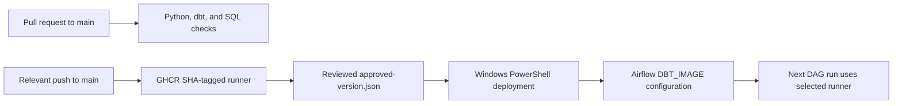

# CI/CD and local deployment

The project validates pull requests in GitHub Actions, publishes a versioned dbt runner to GHCR, and promotes an approved image to a local Windows Docker Desktop host. The deployment is a portfolio proof of concept operated from that host.



## Pull request validation

[Medical Billing CI](../.github/workflows/ci.yml) runs on pull requests targeting `main`. Jobs use Python 3.12 on Ubuntu.

| Check | What runs |
| --- | --- |
| Python syntax | `compileall` checks the simulator and Airflow DAG directory. |
| Python lint | Ruff checks the simulator and DAG code. |
| dbt project | Installs dbt-sqlserver 1.12.1 and runs `dbt parse --target dev --profiles-dir config` with placeholder connection values. |
| SQL lint | SQLFluff lints `models/` using the T-SQL dialect and the workflow's Jinja templater override. |

Database-backed models and data tests run through `dbt build` in a configured environment. The repository defines the checks. Required-check enforcement depends on GitHub branch settings.

## Image publication and approval

[dbt Container Delivery](../.github/workflows/dbt-delivery.yml) runs on pushes to `main` affecting `medical_billing_dbt/**` or the delivery workflow. Docker Buildx builds [the Airflow runner](../medical_billing_dbt/Dockerfile.airflow-runner) and publishes it using the workflow's `GITHUB_TOKEN` with package write permission. The workflow publishes `ghcr.io/omarpeguero/medical-billing-dbt:sha-<full-commit-sha>` with source and revision labels.

Treat each SHA tag as immutable in the release process. These references are registry tags, which can be reassigned by a publisher. Digest pinning would enforce content identity. The workflow publishes the image and leaves the approval manifest unchanged.

[approved-version.json](../deployment/approved-version.json) selects the release. Review the published image and update the manifest's `image` field on `main` while retaining `"environment": "local"`. This is repository-level approval. The poller reads the manifest from the upstream repository's `main` and validates its environment and full-SHA image pattern. A fork needs its own registry and manifest configuration. Publishing and editing the manifest do not themselves recreate the local container.

## Deploy on Windows

Start Docker Desktop and initialize the Airflow stack using the [local setup](../README.md#local-setup). The scripts expect an existing `medical_billing_airflow` container, an ignored `medical_billing_airflow/.env` with a matching `DBT_IMAGE` and the required `AIRBYTE_CONNECTION_ID`, a dbt connection environment file, and permission to pull from GHCR. Authenticate to the registry if the package requires it. From the repository root:

```powershell
.\deployment\check-deployment.ps1 -DryRun
.\deployment\check-deployment.ps1
```

The dry run reads and validates the remote manifest and checks the failure marker without attempting a rollout. For an explicit operator-selected release, run:

```powershell
$approved = Get-Content .\deployment\approved-version.json -Raw | ConvertFrom-Json
.\deployment\deploy.ps1 -Image $approved.image
```

The direct command uses the local file in this example. The deployment engine validates the image reference without fetching the remote manifest. Use one deployment entry point at a time. The polling script uses a named mutex, while direct calls to the deployment engine lack that protection.

Windows Task Scheduler can invoke `check-deployment.ps1` periodically. **Scheduled polling is disabled by user preference.** The schedule and task registration live outside this repository. Run the checks manually when needed.

## Health, history, and rollback

1. The deployment engine checks Docker, pulls and inspects the requested image, and compares `DBT_IMAGE` in the environment file and running Airflow container. A mismatch stops the rollout. An already selected image results in a no-op after preflight.
2. It backs up the Airflow environment file, changes `DBT_IMAGE`, validates Compose, and recreates only the Airflow service. The script checks the container's running state and separately compares its `DBT_IMAGE` environment value to the requested runner reference. It then waits up to 120 seconds for Docker to report the container as healthy. The Compose probe uses `curl --fail` against Airflow's `/api/v2/monitor/health` endpoint inside the container.
3. If rollout fails after the backup, the engine restores the saved environment, recreates Airflow, and verifies the previous reference and health. It reports failure even when rollback succeeds. `-SimulateFailure` exercises this path for a deployment that reaches the post-health check.
4. The engine attempts to append a timestamped entry to `deployment/.state/deployment-history.jsonl`, with previous and requested refs and a `success`, `rolled_back`, or `rollback_failed` result. Early preflight failures and no-ops may have no entry. The poller records a failed release in `failed-image.json` and will skip that image until a different version is approved or the marker is cleared. Keep the ignored state directory private because the backup copies the full Airflow environment file.

For end-to-end validation of the ingestion and warehouse build after deployment, trigger `medical_billing_ingestion` and confirm that both `sync_postgres_to_sqlserver` and `dbt_build_and_test` succeed. This exercises the Airbyte sync and the deployed dbt runner, including warehouse tests. Rollback restores runner configuration. Any warehouse changes from a prior run require separate recovery.

## Development and production considerations

The local dbt Compose service bind-mounts the checkout and defaults to the `dev` schemas. The packaged runner uses the `prod` target for the shared SQL Server schemas consumed by Power BI. Both use credentials supplied at runtime. Airflow runs in standalone mode on the Windows Docker host and mounts the Docker socket. A managed production rollout would require its own scheduler and metadata database, restricted runtime privileges, managed credentials, verified TLS, release controls, and operational monitoring. [dbt targets and connection settings](../medical_billing_dbt/README.md#targets-and-credentials)
